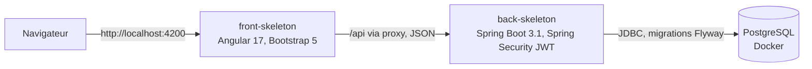

# Mijoté, Meal Planner et Food Tracker

[](https://github.com/dev-Clarisse/Meal-plan/actions/workflows/backend-ci.yml)

Mijoté est une application web pour organiser ses repas : un catalogue de recettes, un inventaire de ce que l'on a dans son frigo avec des alertes de péremption, et, à terme, un planning hebdomadaire et une liste de courses calculée automatiquement.

## Sommaire

1. [Présentation](#présentation)
2. [Aperçu de l'application](#aperçu-de-lapplication)
3. [Équipe et répartition](#équipe-et-répartition)
4. [Architecture](#architecture)
5. [Stack technique](#stack-technique)
6. [Modèle de données](#modèle-de-données)
7. [API REST](#api-rest)
8. [Installation et lancement](#installation-et-lancement)
9. [Tests](#tests)
10. [Intégration continue](#intégration-continue)
11. [Conventions et bonnes pratiques](#conventions-et-bonnes-pratiques)
12. [Utilisation de l'IA](#utilisation-de-lia)
13. [Dépannage](#dépannage)
14. [Feuille de route](#feuille-de-route)

## Présentation

### Le problème

Planifier ses repas demande de jongler entre trois informations : les recettes que l'on aime, ce qu'il reste dans le frigo et ce qui va bientôt se périmer. Mijoté rassemble ces trois informations au même endroit.

### Fonctionnalités

| Domaine | Ce que l'utilisateur peut faire |
|---|---|
| Compte | S'inscrire et se connecter de façon sécurisée |
| Recettes | Consulter, rechercher par titre, créer, modifier et supprimer des recettes |
| Ingrédients | Choisir les ingrédients d'une recette dans un catalogue partagé, en tapant pour filtrer |
| Inventaire | Suivre le contenu du frigo avec quantité, unité et date de péremption, et repérer les produits expirés ou bientôt périmés |
| Notifications | Être prévenu des péremptions grâce à la cloche de la barre de navigation |
| Planning | Organiser les repas de la semaine à partir de ses recettes |
| Liste de courses | Obtenir les ingrédients à acheter, calculés à partir du planning et de l'inventaire, avec conversion entre unités compatibles (g et kg, ml et l) |

## Aperçu de l'application


## Équipe et répartition

| Membre | Responsabilités |
|---|---|
| Clarisse | Authentification et utilisateurs, inventaire, alertes de péremption, notifications, fonctionnalité de génération de recettes par IA |
| Maria Leticia | Recettes, ingrédients, unités, interface (thème, navigation, composants partagés), tests des recettes (back et front), intégration continue, README, skill IA (SKILL.md) pour la création de pages du front |
| Georgette | Planning, liste de courses, ingrédients manquants, tests d'intégration, démonstration finale |

Les trois parties s'emboîtent : les recettes viennent de Maria Leticia, le stock de Clarisse, le calcul et la liste de courses de Georgette.

## Architecture

Le dépôt contient deux applications indépendantes et un fichier Docker Compose pour la base de données.



En développement, le serveur Angular redirige les appels `/api` vers le back sur le port 8085 grâce à `proxy.conf.json`.

### Structure du dépôt

```text
.
|-- back-skeleton/
|   |-- src/main/java/com/takima/backskeleton/
|   |   |-- Auth/            authentification et jetons JWT
|   |   |-- User/            utilisateurs et administration
|   |   |-- Inventory/       inventaire, notifications, alertes de péremption
|   |   |-- ingredient/      catalogue d'ingrédients
|   |   |-- recipe/          recettes et lignes d'ingrédients
|   |   |-- common/unit/     unités et conversions
|   |   `-- config/          sécurité et propriétés
|   |-- src/main/resources/
|   |   |-- db/migration/    migrations Flyway
|   |   `-- db/seed/         données de démonstration (profil demo)
|   |-- src/test/            tests unitaires et d'intégration
|   |-- docker-compose.yml
|   `-- .env.sample
|-- front-skeleton/
|   `-- src/app/
|       |-- core/            guards, intercepteurs, modèles, services
|       |-- features/        auth, landing, recipes, inventory, notifications
|       `-- shared/          navbar, auth-layout, back-link, confirm-dialog, toast, directives
|-- .github/workflows/       intégration continue
|-- docs/previews/        aperçu animé du README
```

   Le code front est organisé par fonctionnalité : chaque dossier regroupe les composants, services et modèles d'une même partie de l'application.

## Stack technique

### Back

| Outil | Rôle |
|---|---|
| Java 17 (testé aussi en 21) | Langage |
| Spring Boot 3.1.3 | Framework applicatif |
| Spring Data JPA et Hibernate | Accès aux données |
| Spring Security | Ressource serveur JWT, jetons signés en HS256, mots de passe hachés avec BCrypt |
| PostgreSQL | Base de données (Docker) |
| Flyway | Évolution du schéma par migrations versionnées |
| JUnit 5, Mockito, MockMvc, H2 | Tests |
| Maven | Build |

### Front

| Outil | Rôle |
|---|---|
| Angular 17 | Framework (composants standalone, signals, nouvelle syntaxe de contrôle) |
| Bootstrap 5 et Bootstrap Icons | Composants et icônes |
| Sass | Thème (variables CSS olive, terracotta) |
| Cormorant Garamond, Playfair Display, Inter | Typographies |
| Karma et Jasmine | Tests |

## Modèle de données

Le schéma est géré uniquement par les migrations Flyway.

| Table | Contenu |
|---|---|
| `users` | Comptes, rôle, date de consentement |
| `inventory` | Articles du frigo par utilisateur (nom, quantité, unité, date de péremption) |
| `notifications` | Notifications générées pour un utilisateur |
| `ingredients` | Catalogue partagé (nom, unité par défaut) |
| `recipes` | Titre, nombre de portions, préparation |
| `recipe_ingredients` | Lignes d'une recette (ingrédient, quantité, unité) |

Règles de conception :

- Les quantités sont en `BigDecimal`, jamais en nombre à virgule flottante.
- Les conversions arrondissent à six décimales (mode HALF_UP).
- Les relations JPA sont en chargement paresseux.
- Chaque requête de l'inventaire est filtrée sur l'utilisateur connecté.
- Une migration déjà appliquée n'est jamais renommée ni modifiée.

### Unités

Les unités disponibles sont `G`, `KG`, `ML`, `L`, `TSP`, `TBSP` et `PIECE`. Une conversion entre unités de familles différentes est refusée avec une exception dédiée.

## API REST

Toutes les routes, sauf l'inscription et la connexion, exigent un jeton JWT dans l'en-tête `Authorization: Bearer <jeton>`.

| Méthode | Route | Description | Accès |
|---|---|---|---|
| POST | `/api/users` | Inscription | Public |
| POST | `/api/auth/login` | Connexion, retourne le jeton | Public |
| GET | `/api/v1/ingredients` | Recherche dans le catalogue (paramètre `query`) | Connecté |
| GET | `/api/v1/recipes` | Liste paginée (paramètres `title`, `page`, `size`) | Connecté |
| GET | `/api/v1/recipes/{id}` | Détail d'une recette | Connecté |
| POST | `/api/v1/recipes` | Création | Connecté |
| PUT | `/api/v1/recipes/{id}` | Modification | Connecté |
| DELETE | `/api/v1/recipes/{id}` | Suppression | Connecté |
| GET, POST, PUT, DELETE | `/api/inventory/**` | Inventaire de l'utilisateur | Connecté |
| GET, PUT | `/api/notifications/**` | Notifications de l'utilisateur | Connecté |

La taille de page des recettes est plafonnée à 50 et le tri se fait par titre.

## Installation et lancement

### Prérequis

- Java 17 ou supérieur
- Maven 3.8 ou supérieur
- Node.js 18.13 ou supérieur (20 recommandé) et npm
- Docker et Docker Compose
- Google Chrome ou Chromium pour les tests du front

### 1. Cloner le dépôt

```bash
git clone https://github.com/dev-Clarisse/Meal-plan.git
cd Meal-plan
```

### 2. Configurer l'environnement

```bash
cd back-skeleton
cp .env.sample .env
```

Renseigner au minimum les variables suivantes dans `.env`. Le fichier `.env.sample` reste la référence pour la liste complète.

| Variable | Description |
|---|---|
| `JWT_SECRET` | Secret de signature des jetons, 32 octets minimum encodés en Base64 |
| `ADMIN_EMAIL` | Adresse du compte administrateur créé au démarrage |
| `ADMIN_PASSWORD` | Mot de passe de l'administrateur, 12 caractères minimum |
| `DATABASE_PASSWORD` | Mot de passe de la base PostgreSQL |
| `DATABASE_PORT` | Port de la base sur la machine (5432 par défaut) |
| `SPRING_PROFILES_ACTIVE` | Mettre `demo` pour charger des recettes d'exemple (facultatif) |

Générer un secret JWT valide :

```bash
openssl rand -base64 32
```

Le fichier `.env` contient des secrets : il ne doit jamais être commité.

### 3. Démarrer la base de données

```bash
cd back-skeleton
docker compose up -d database
```

### 4. Démarrer le back

```bash
cd back-skeleton
set -a; source .env; set +a
mvn spring-boot:run -Dspring-boot.run.arguments=--server.port=8085
```

Au premier démarrage, Flyway crée le schéma et insère le catalogue d'ingrédients.

### 5. Démarrer le front

```bash
cd front-skeleton
npm install
npm start
```

L'application est disponible sur `http://localhost:4200`.

### Données de démonstration

Avec `SPRING_PROFILES_ACTIVE=demo`, le back ajoute 12 recettes d'exemple et les ingrédients associés. Ces données se trouvent dans `back-skeleton/src/main/resources/db/seed/` et ne sont jamais chargées sans ce profil, ni en production ni dans les tests.

Pour repartir d'une base vide :

```bash
cd back-skeleton
docker compose down -v
docker compose up -d database
```

## Tests

### Back

```bash
cd back-skeleton
mvn clean verify
```

Les tests utilisent une base H2 en mémoire en mode PostgreSQL, avec les mêmes migrations Flyway. Ils couvrent les unités, les services, les contrôleurs (MockMvc avec authentification simulée) et la sécurité.

### Front

```bash
cd front-skeleton
npx ng test --watch=false
```

Les tests utilisent Karma et Jasmine. Les spécifications se trouvent à côté des composants et des services (`*.spec.ts`). Pour les recettes, elles couvrent le service HTTP, la liste, le détail et le formulaire, avec des données de test partagées dans `features/recipes/testing/`.

Si Chrome n'est pas détecté, indiquer son chemin :

```bash
export CHROME_BIN=$(which chromium-browser)
```

## Intégration continue

Un workflow GitHub Actions (`.github/workflows/backend-ci.yml`) s'exécute sur chaque pull request. Il installe Java 21 et lance `mvn -B verify`, qui compile le back et exécute tous ses tests.

## Conventions et bonnes pratiques

### Git

- Deux branches protégées : `main` et `develop`. Toute modification passe par une pull request vers `develop`.
- Une branche par fonctionnalité, nommée `feature/...`, `fix/...`, `refactor/...` ou `test/...`.
- Les messages de commit suivent le format `type: résumé`, par exemple `feat: add recipe search`.
- Le rebase est préféré au merge pour garder un historique lisible.
- Les pull requests sont relues par un autre membre de l'équipe : personne ne valide son propre travail.
- Les fichiers `.env`, `.idea`, `.vscode`, `target` et `node_modules` ne sont jamais commités.

### Back

- Code en anglais et en camelCase, sans commentaires : le nommage doit suffire.
- Architecture en couches : pas de logique métier dans les contrôleurs.
- Verbes et codes d'erreur HTTP cohérents.
- Utilisation des records pour les objets de transfert.
- Le schéma évolue uniquement par de nouvelles migrations Flyway.

### Front

- Code organisé par fonctionnalité.
- Composants standalone, réutilisables, avec une seule responsabilité.
- Signals plutôt que NgModules, avec désabonnement automatique des appels HTTP (`takeUntilDestroyed`).
- Couleurs uniquement via les variables CSS du thème.
- Composants partagés disponibles : boîte de confirmation (`ConfirmService`), notifications (`ToastService`), bouton de retour, directive d'apparition au défilement.

### Ajouter une page au front

1. Créer le dossier `src/app/features/<nom>/` avec un composant standalone.
2. Déclarer la route dans `src/app/app.routes.ts` avec `canActivate: [authGuard]`.
3. Ajouter une entrée dans `src/app/shared/navbar/nav-items.ts` :

```ts
{ label: 'Planning', path: '/planning' },
```

## Utilisation de l'IA

L'IA est utilisée de deux façons dans ce projet.

### Fonctionnalité dans l'application

Le formulaire de recette peut proposer un brouillon généré par un modèle de langage exécuté localement avec Ollama. Aucune clé d'API n'est nécessaire.

| Variable | Valeur par défaut | Description |
|---|---|---|
| `OLLAMA_URL` | `http://localhost:11434` | Adresse du serveur Ollama |
| `OLLAMA_MODEL` | `llama3.2:3b` | Modèle utilisé |
| `OLLAMA_TIMEOUT` | `120` | Délai maximal en secondes |

Installation locale :

```bash
curl -fsSL https://ollama.com/install.sh | sh
ollama pull llama3.2:3b
ollama serve
```

Les réponses du modèle sont des brouillons : l'utilisateur les relit et les modifie avant d'enregistrer.

### Skill pour un outil de code IA

Le dossier `skills/add-front-page/` contient un skill conçu avec la méthode Gechev. Il décrit à une IA de code comment ajouter une page protégée au front : dossier de feature, route avec `authGuard` et entrée dans la barre de navigation.

Le skill a été validé en quatre étapes avec une IA :

| Étape | Objectif | Résultat |
|---|---|---|
| 1. Découverte | Vérifier que la description déclenche le skill au bon moment | Ajout d'une exclusion pour le simple lien de navigation |
| 2. Logique | Parcourir chaque étape et repérer les contradictions | Vérifications placées avant toute création, fichiers du composant précisés, valeurs par défaut ajoutées |
| 3. Cas limites | Tester les doublons, la langue des noms, les erreurs de build et les pages publiques | Build de référence, normalisation du nom, pages publiques exclues |
| 4. Affinage | Supprimer les redondances et les incohérences | `npm ci` à la place de `npm install`, version finale plus courte |

[Conversation de validation](https://claude.ai/share/c76adc79-4ebc-4c01-b6c1-d5fd6c831d23)

### Assistant de code pour le développement

Un assistant de code IA a servi à guider la conception, à écrire et relire le code et les tests, et à rédiger la documentation. Toutes les contributions ont été relues, exécutées et validées par l'équipe.

## Dépannage

| Symptôme | Cause probable | Solution |
|---|---|---|
| `Migration checksum mismatch` au démarrage | Les migrations ont changé depuis la création de la base locale | `docker compose down -v`, puis relancer la base |
| `Found more than one migration with version` | Dossier `target/` périmé | `mvn clean` ou supprimer `target/` |
| `Port 8085 was already in use` | Un ancien back tourne encore | `ss -ltnp \| grep 8085`, puis arrêter le processus indiqué |
| Variables lues avec un caractère parasite | Fins de ligne Windows dans `.env` | `sed -i 's/\r$//' .env` |
| `No binary for Chrome browser` | Chrome absent | Installer Chromium et définir `CHROME_BIN` |
| Le front affiche une erreur de chargement | Le back n'est pas démarré sur le port 8085 | Démarrer le back, vérifier `proxy.conf.json` |

## Feuille de route

- Planning hebdomadaire des repas.
- Liste de courses calculée à partir du planning et de l'inventaire.
- Rapprochement des articles de l'inventaire avec le catalogue d'ingrédients.
- Unification des préfixes d'API (`/api` et `/api/v1`) et d'une liste unique d'unités.
- Documentation OpenAPI de l'API.
- Tests du front pour l'inventaire, l'authentification et la navigation.
